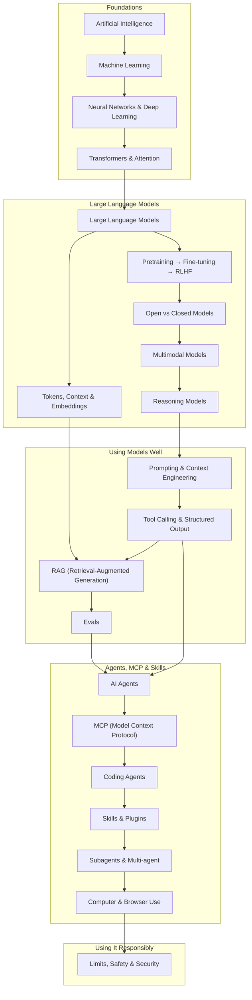

<!-- GENERATED by scripts/build.mjs from data/roadmap.json. Edit the data, not this file. -->
# 🗺️ The AI Map

**How we got from machine learning to agents, skills and plugins, and how the pieces fit together.**
21 short stops. Each one covers what it is, how it fits, one thing to try, and one great resource.
Interactive version with progress tracking: [AI Map on the website](https://vivekanand30.github.io/ai-atlas/learn.html) · Next: [AI for your role](ROLES.md)

## Foundations 1956 – 2017

*How machines learned to learn*

### 1. Artificial Intelligence 1956 →

**What it is:** The broad goal of making computers do things that normally need human intelligence. Early AI was hand-written rules: if X, then Y.

**How it fits:** Everything on this map is a branch of AI. The big shift was from rules people write to patterns machines learn.

> 💡 Rule-based AI is a recipe book. Learning-based AI is a cook who learned by tasting thousands of dishes.

**Try it:** List three AI systems you used today without noticing, such as a spam filter, recommendations or map routing.

**Best resource:** [Elements of AI: free beginner course](https://www.elementsofai.com/)

**Next →** Machine Learning

### 2. Machine Learning 1990s →

**What it is:** Instead of writing rules, you show the computer many labelled examples, such as emails marked spam or not spam, and it learns the pattern.

**How it fits:** Classic ML (decision trees, regression) still powers most business predictions. Its limit is that people must choose which features matter.

> 💡 Like learning to spot ripe fruit from hundreds of examples instead of memorizing a checklist.

**Try it:** Do the first module of Google's free Machine Learning Crash Course.

**Tools:** [Jupyter](https://jupyter.org/)

**Best resource:** [Google Machine Learning Crash Course](https://developers.google.com/machine-learning/crash-course)

**Next →** Neural Networks & Deep Learning

### 3. Neural Networks & Deep Learning 2012 →

**What it is:** Networks with many layers of simple artificial neurons that learn useful features by themselves from raw data like pixels, sound or text.

**How it fits:** It took off once big datasets and GPUs arrived. In 2012 AlexNet won a major image-recognition contest by a wide margin and started the deep learning era. Every modern AI model is a deep network.

> 💡 Early layers notice edges, middle layers notice shapes, later layers notice faces. Nobody tells it to; it learns that structure.

**Try it:** Watch the first 3Blue1Brown video on neural networks (about 20 minutes).

**Tools:** [PyTorch](https://pytorch.org/)

**Best resource:** [3Blue1Brown: Neural networks (visual series)](https://www.3blue1brown.com/topics/neural-networks)

**Next →** Transformers & Attention

### 4. Transformers & Attention 2017

**What it is:** A network design where every word can attend to every other word to understand context, and that trains efficiently in parallel.

**How it fits:** The architecture behind every LLM; it's the T in GPT. It made training on internet-scale text practical.

> 💡 Reading a sentence while keeping every other word in view, instead of one word at a time.

**Try it:** Skim the diagrams in The Illustrated Transformer. You don't need the math to get the idea.

**Tools:** [Transformers](https://huggingface.co/docs/transformers)

**Best resource:** [Jay Alammar: The Illustrated Transformer](https://jalammar.github.io/illustrated-transformer/)

**Next →** Large Language Models

---

## Large Language Models 2018 – 2024

*Prediction at internet scale*

### 5. Large Language Models 2020 →

**What it is:** Huge transformers trained to predict the next word across a large part of the internet. At enough scale, that single skill becomes writing, reasoning, translating and coding.

**How it fits:** GPT-3 (2020) showed what scale can do. ChatGPT (Nov 2022) turned it into a product anyone could use. Everything after this on the map builds on LLMs.

> 💡 A world-class autocomplete that has read more than any human could, and so picked up a lot of how the world works.

**Try it:** Ask an assistant the same question three ways and compare the answers. Notice how the wording changes the result.

**Tools:** [ChatGPT](https://chatgpt.com/) · [Claude](https://claude.ai/) · [Gemini](https://gemini.google.com/)

**Best resource:** [Andrej Karpathy: Intro to Large Language Models (1h)](https://www.youtube.com/watch?v=zjkBMFhNj_g)

**Next →** Tokens, Context & Embeddings, Pretraining → Fine-tuning → RLHF

### 6. Tokens, Context & Embeddings core idea

**What it is:** Models read text as tokens (word pieces). The context window is how many tokens they can see at once. Embeddings turn text into lists of numbers where similar meanings land close together.

**How it fits:** Tokens explain pricing and length limits. Embeddings power semantic search and RAG later on the map.

> 💡 Embeddings are coordinates on a map of meaning: 'puppy' sits near 'dog' and far from 'invoice'.

**Try it:** Paste a paragraph into a tokenizer tool and count the tokens. Notice how rare words split into pieces.

**Tools:** [Sentence Transformers](https://sbert.net/)

**Best resource:** [Jay Alammar: The Illustrated Word2vec](https://jalammar.github.io/illustrated-word2vec/)

**Next →** RAG (Retrieval-Augmented Generation)

### 7. Pretraining → Fine-tuning → RLHF core idea

**What it is:** Pretraining teaches language from raw text. Fine-tuning teaches a task or format. RLHF (learning from human preference ratings) teaches the model to be helpful and safe.

**How it fits:** This is why a raw model rambles but a chat model answers. You can fine-tune open models yourself, but try prompting first.

> 💡 Pretraining is reading the whole library, fine-tuning is job training, and RLHF is feedback from customers.

**Try it:** Open a free Unsloth Colab notebook and look at what a fine-tuning dataset looks like.

**Tools:** [Unsloth](https://unsloth.ai/) · [TRL](https://huggingface.co/docs/trl)

**Best resource:** [Hugging Face: Illustrating RLHF](https://huggingface.co/blog/rlhf)

**Next →** Open vs Closed Models

### 8. Open vs Closed Models 2023 →

**What it is:** Closed models (Claude, GPT, Gemini) run behind an API. Open-weight models (Llama, Qwen, Mistral, DeepSeek and others) can be downloaded and run on your own hardware.

**How it fits:** Closed models are usually the most capable. Open models give you privacy, control and no per-token cost.

**Try it:** Install Ollama and chat with a small model completely offline.

**Tools:** [Ollama](https://ollama.com/) · [Hugging Face Hub](https://huggingface.co/) · [OpenRouter](https://openrouter.ai/)

**Best resource:** [Hugging Face LLM Course (free)](https://huggingface.co/learn/llm-course)

**Next →** Multimodal Models

### 9. Multimodal Models 2023 →

**What it is:** Models that take in and produce more than text: images, audio and video.

**How it fits:** Makes screenshot understanding, voice assistants and image generation possible, and it's how agents can see screens.

**Try it:** Upload a photo of a chart or handwritten note to an assistant and ask it to explain it.

**Tools:** [Gemini API](https://ai.google.dev/) · [ComfyUI](https://www.comfy.org/) · [ElevenLabs](https://elevenlabs.io/)

**Next →** Reasoning Models

### 10. Reasoning Models 2024 →

**What it is:** Models trained to think step by step before answering, spending more compute on harder problems.

**How it fits:** Brought big jumps in math, coding and planning, and they're the backbone of capable agents. OpenAI's o1 (Sept 2024) started the wave; now most frontier models can reason.

**Try it:** Give a tricky logic puzzle to a model with extended thinking on and off, and compare the answers.

**Tools:** [Claude API](https://docs.claude.com/) · [OpenAI API](https://platform.openai.com/)

**Best resource:** [OpenAI: Learning to reason with LLMs](https://openai.com/index/learning-to-reason-with-llms/)

**Next →** Prompting & Context Engineering

---

## Using Models Well 2023 →

*Getting reliable results*

### 11. Prompting & Context Engineering 2023 →

**What it is:** Getting good results with clear instructions, examples and the right information. Context engineering is the broader skill of choosing everything the model sees.

**How it fits:** The cheapest, fastest lever. Try it before reaching for RAG, fine-tuning or agents.

**Try it:** Rewrite a vague prompt with a role, the goal, an example of good output and the format you want. Compare the results.

**Tools:** [DSPy](https://dspy.ai/) · [BAML](https://docs.boundaryml.com/)

**Best resource:** [Anthropic: Prompt engineering guide](https://docs.claude.com/en/docs/build-with-claude/prompt-engineering/overview)

**Next →** Tool Calling & Structured Output

### 12. Tool Calling & Structured Output 2023

**What it is:** The model replies with a structured request like get_weather(city="Paris"), your code runs it, and the result goes back to the model. Structured output guarantees JSON you can parse.

**How it fits:** The bridge from talking to doing. Agents and MCP are built on it.

> 💡 The model can't use a calculator itself, but it can ask you to press the buttons and tell it the answer.

**Try it:** Follow the tool-use quickstart and give a model one function, such as current time.

**Tools:** [Instructor](https://python.useinstructor.com/) · [Outlines](https://dottxt-ai.github.io/outlines/)

**Best resource:** [Claude docs: Tool use overview](https://docs.claude.com/en/docs/build-with-claude/tool-use/overview)

**Next →** RAG (Retrieval-Augmented Generation), AI Agents

### 13. RAG (Retrieval-Augmented Generation) 2023 →

**What it is:** Find the relevant pieces of your documents, using embeddings and a vector database, and put them in the prompt so the model answers from your data.

**How it fits:** How chatbots answer questions about company docs without retraining. Often the first real AI app a team builds.

> 💡 An open-book exam: the model doesn't memorize your docs, it looks up the right page first.

**Try it:** Upload three PDFs to NotebookLM and ask a question that needs two of them. That's RAG with no code.

**Tools:** [Docling](https://docling-project.github.io/docling/) · [LlamaIndex](https://www.llamaindex.ai/) · [pgvector](https://github.com/pgvector/pgvector) · [NotebookLM](https://notebooklm.google/)

**Next →** Evals

### 14. Evals 2023 →

**What it is:** Tests for AI behavior: sets of inputs with checks on the outputs, run on every change.

**How it fits:** LLMs are unpredictable, so evals are how you know a change made things better, not worse. Teams that win at AI are usually the ones with good evals.

**Try it:** Write 10 real questions with good answers for your use case. That's your first eval set.

**Tools:** [promptfoo](https://www.promptfoo.dev/) · [Langfuse](https://langfuse.com/) · [Ragas](https://docs.ragas.io/)

**Best resource:** [Hamel Husain: Your AI product needs evals](https://hamel.dev/blog/posts/evals/)

**Next →** AI Agents

---

## Agents, MCP & Skills 2024 →

*From answering to doing*

### 15. AI Agents 2024 →

**What it is:** An LLM in a loop: it decides which tool to use, looks at the result, and repeats until the task is done.

**How it fits:** Combines reasoning, tool calling and context. Start with simple fixed workflows and reach for full autonomy only when you need it.

> 💡 A chatbot answers your question. An agent takes the errand and comes back when it's done.

**Try it:** Read 'Building effective agents' and sort what you do at work into workflow steps or agent tasks.

**Tools:** [Claude Agent SDK](https://docs.claude.com/en/api/agent-sdk/overview) · [LangGraph](https://langchain-ai.github.io/langgraph/) · [OpenAI Agents SDK](https://openai.github.io/openai-agents-python/)

**Best resource:** [Anthropic: Building effective agents](https://www.anthropic.com/engineering/building-effective-agents)

**Next →** MCP (Model Context Protocol)

### 16. MCP (Model Context Protocol) Nov 2024 →

**What it is:** An open standard for plugging tools and data into any AI app: build a connector once and use it in Claude, ChatGPT, Cursor and more.

**How it fits:** It's how agents reach GitHub, Figma, databases and browsers. MCP answers 'what can the agent touch?'

> 💡 USB-C for AI: one plug shape, so any device works with any port.

**Try it:** Add the Playwright MCP server to your AI app and ask it to open a website and summarize it.

**Tools:** [Model Context Protocol](https://modelcontextprotocol.io/) · [FastMCP](https://gofastmcp.com/) · [Figma MCP Server](https://developers.figma.com/docs/figma-mcp-server/) · [GitHub MCP Server](https://github.com/github/github-mcp-server)

**Best resource:** [Anthropic: Introducing the Model Context Protocol](https://www.anthropic.com/news/model-context-protocol)

**Next →** Coding Agents

### 17. Coding Agents 2025 →

**What it is:** Agents that read a codebase, edit files, run commands and tests, and keep iterating, from your terminal or IDE.

**How it fits:** The most mature kind of agent so far, and where skills and plugins took off. Useful for non-coders too, for file and data chores.

**Try it:** Ask a coding agent to explain an unfamiliar repo, then make one small change and run the tests.

**Tools:** [Claude Code](https://claude.com/claude-code) · [Cursor](https://cursor.com/) · [OpenAI Codex](https://developers.openai.com/codex)

**Next →** Skills & Plugins

### 18. Skills & Plugins Oct 2025 →

**What it is:** A skill is a folder of instructions (SKILL.md) plus optional scripts that an agent loads only when a task needs it. A plugin bundles skills, MCP servers, commands and hooks into one install.

**How it fits:** MCP gives agents tools; skills give them know-how. Skills are now an open format used across many agents.

> 💡 MCP hands the agent a toolbox. A skill hands it the expert's playbook for using it.

**Try it:** Install Anthropic's frontend-design or docx skill and ask for a landing page or a formatted report.

**Tools:** [Anthropic Skills](https://github.com/anthropics/skills) · [skills (npx skills)](https://skills.sh/) · [Dembrandt Skills](https://www.dembrandt.com/skills)

**Best resource:** [Anthropic: Equipping agents with Agent Skills](https://www.anthropic.com/engineering/equipping-agents-for-the-real-world-with-agent-skills)

**Next →** Subagents & Multi-agent

### 19. Subagents & Multi-agent 2025 →

**What it is:** A lead agent hands parts of a job to subagents. Each gets a fresh context, and they can work in parallel.

**How it fits:** How agents handle big jobs like deep research or large refactors without overflowing their context.

**Tools:** [LangGraph](https://langchain-ai.github.io/langgraph/) · [Claude Agent SDK](https://docs.claude.com/en/api/agent-sdk/overview)

**Best resource:** [Anthropic: Effective context engineering for agents](https://www.anthropic.com/engineering/effective-context-engineering-for-ai-agents)

**Next →** Computer & Browser Use

### 20. Computer & Browser Use Oct 2024 →

**What it is:** Agents that operate screens and browsers like a person: look, click, type.

**How it fits:** Reaches apps that have no API. Slower and less reliable than APIs or MCP, so use it as the fallback.

**Tools:** [Browser Use](https://browser-use.com/) · [Playwright MCP](https://github.com/microsoft/playwright-mcp) · [Stagehand](https://www.stagehand.dev/)

**Best resource:** [Anthropic: Introducing computer use](https://www.anthropic.com/news/3-5-models-and-computer-use)

**Next →** Limits, Safety & Security

---

## Using It Responsibly always

*Know the limits*

### 21. Limits, Safety & Security always

**What it is:** Models hallucinate, can be tricked by prompt injection hidden in content they read, and agents can take real actions.

**How it fits:** The more autonomy you give AI, the more guardrails, sandboxes and human review you need.

**Try it:** Ask an assistant for sources on a niche topic and check whether every citation actually exists.

**Tools:** [garak](https://garak.ai/) · [Llama Guard](https://www.llama.com/trust-and-safety/) · [E2B](https://e2b.dev/)

**Best resource:** [Simon Willison: Prompt injection series](https://simonwillison.net/series/prompt-injection/)

